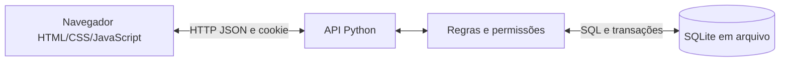

# Arquitetura atual

| Componente | Arquivo | Responsabilidade |
|---|---|---|
| Inicialização | app.py | Dados demonstrativos atômicos e servidor local |
| Interface | static/ | Formulários, navegação e resultados |
| API | energy/http.py | Rotas, autenticação HTTP, origem e arquivos públicos |
| Domínio | energy/service.py | Permissões, cálculos, saldo, estoque, retirada e relatórios |
| Banco | energy/db.py | Esquema, chaves estrangeiras e transações SQLite |

O v3 original tinha persistência no navegador. Seu visual e fluxo foram adaptados para a API. O planejamento inicial citava Java/MySQL; esta entrega usa Python/SQLite para facilitar a execução Windows sem bibliotecas externas. A diferença está explicitada nos slides.

## Tabelas

| Tabela | Conteúdo |
|---|---|
| users | Nome, e-mail único, hash da senha, perfil e meta |
| auth_sessions | Hash do token, usuário e expiração |
| bikes | Identificação e situação |
| rewards | Nome, descrição, custo, estoque, situação e versão |
| rides | Usuário/bicicleta, duração, potência, energia, pontos, regra e datas |
| redemptions | Usuário/benefício, nome/custo históricos, status e confirmação |
| audit | Alterações de retirada, gestor e data |
| settings | Regra de conversão atual |

## Regras

Energia em kWh = watts × minutos / 60.000. Internamente é armazenada em watt-minutos inteiros. Pontos usam arredondamento ao inteiro mais próximo, metade para cima, como no v3: 52,5 → 53. O gestor configura 0,1 a 100 pontos por Wh em passos de 0,1; alterações só afetam novas sessões.

Início simulado = fim menos duração. Não há cronômetro de treino real. Datas usam UTC−3 para a demonstração em Brasília.

Saldo = pontos das sessões menos custos dos resgates. O resgate valida saldo/estoque e grava o débito na mesma transação `BEGIN IMMEDIATE`. Nome e custo do benefício são preservados no histórico. Chaves de idempotência evitam duplicação por repetição da mesma solicitação. Edição do catálogo usa versão para rejeitar estoque desatualizado.

Somente gestor confirma ou reverte retirada; ação, responsável e data ficam registrados. Reverter não restitui pontos/estoque. Alunos consultam somente seus próprios registros. O relatório agrega sessões por intervalo inclusivo de datas.

## Proteções e limites

SQL parametrizado; PBKDF2-SHA256 com salt aleatório; token aleatório guardado como hash; cookie HttpOnly/SameSite=Strict e expiração de oito horas; perfil validado no servidor; validação de origem/host; tamanho JSON limitado; lista explícita de arquivos públicos; texto protegido contra HTML; proteção de fórmulas no CSV. O servidor escuta apenas em 127.0.0.1.

Não há senha fixa no código. Senhas demonstrativas são geradas localmente. A aplicação é para demonstração local, sem HTTPS ou estrutura de produção; não deve ser exposta na internet como está.
